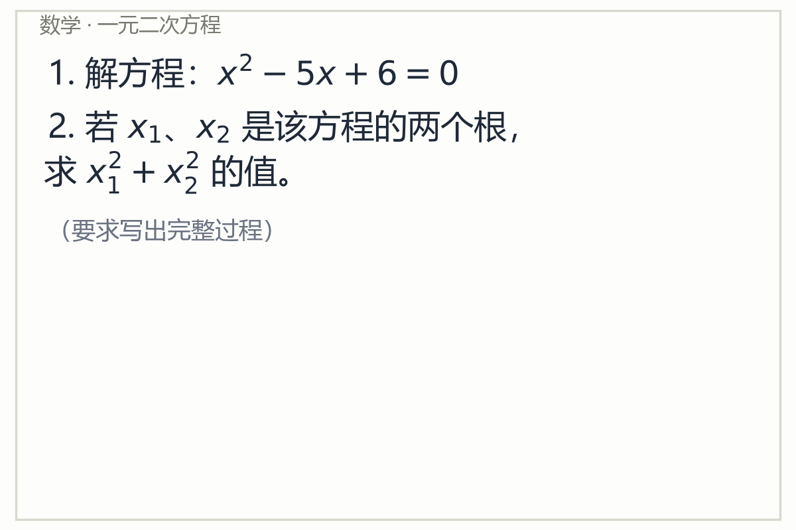
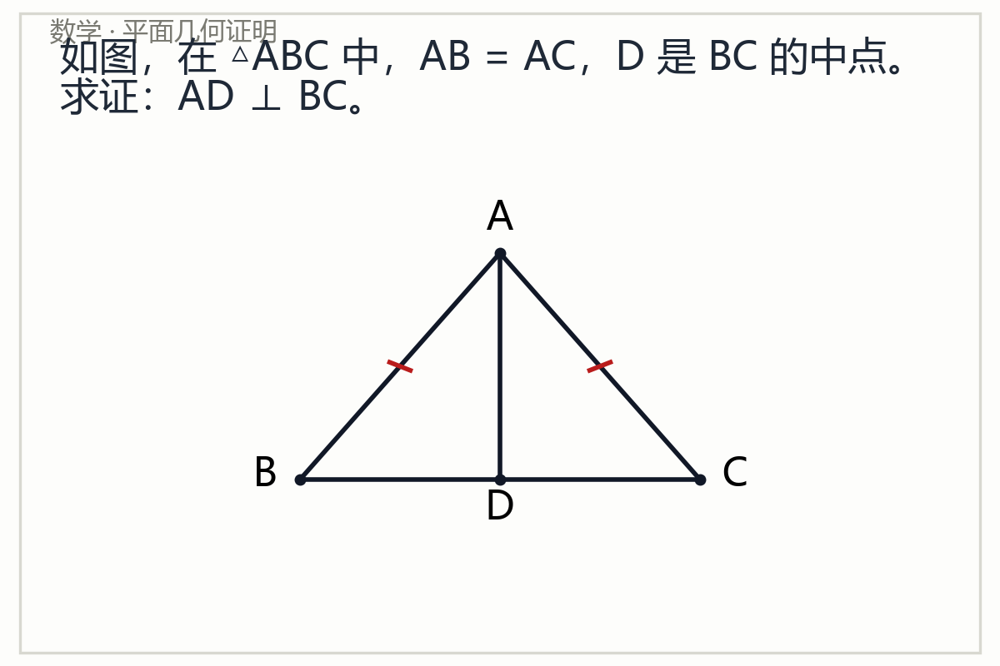
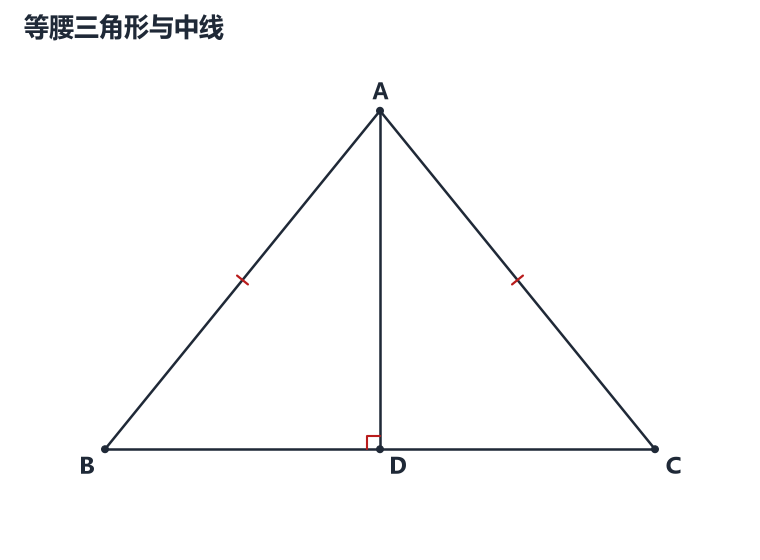
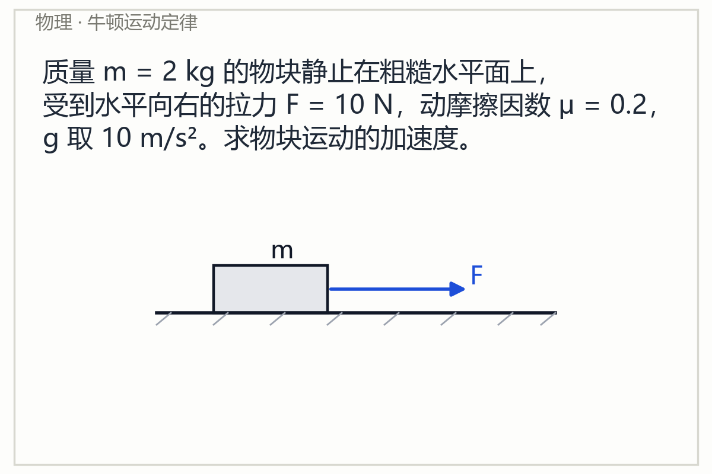
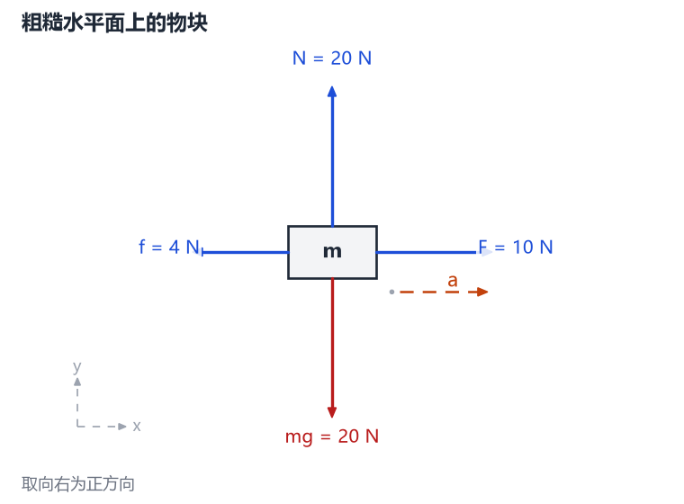

# exam-diagram-solver · 拍题高分解答与自动作图助手

> 上传一道数学或物理题的照片，得到「结构化理解 → 按需作图 → 规范解答 → 程序验证 → 模拟阅卷 → 自动修正」后的可誊写答案。

这是一个 [DeepSeek Harness](https://github.com/deepseek-ai) Host 插件。它不是一个“图片 → OCR → 大模型聊天”的壳，而是一条**带独立校验环节的解题流水线**：

```
题目图片
   │
   ├─ 多模态识别（原图始终参与，OCR 只是辅助）
   │      ↓
   │   ProblemSpec（学科/题型/条件/问题/公式/图中对象与关系/不确定项）
   │      ↓
   ├─ 规则判断是否需要作图，以及图是“辅助图”还是“正式作答图”
   │      ↓
   │   DiagramSpec（LLM 决定画什么）→ 严格 Schema 校验 → 几何关系校验
   │      ↓
   │   程序化渲染（SVG + PNG，程序决定怎么画）
   │      ↓
   ├─ 解题 → AnswerSpec（分步内容、依据、最终答案、可机器验证的断言）
   │      ↓
   ├─ 独立验证（SymPy 回代/恒等式/导数/积分、量纲、数量级、图形关系）
   │      ↓
   ├─ 模拟阅卷（规则评分 + 可选的模型阅卷）→ 失分点
   │      ↓
   └─ 有明确问题？→ 自动修正（有上限）→ 重新验证 → 最终答案
```

**核心原则**：LLM 决定“画什么”，程序决定“怎么画”；LLM 负责推理，程序尽可能负责验证；无法确认时明确表达不确定，而不是编造条件。

---

## Demo

以下全部是仓库内**自编题目**的真实运行结果（非题库扫描件，无版权问题）。

### 1) 数学 · 一元二次方程（不需要作图）

| 题目图片 | 输出 |
|---|---|
|  | 正规考试解答：因式分解 → 两根 → 韦达定理 → `x₁²+x₂²=13`；程序校验 **8/8 通过**；明确判定“不需要作图” |

### 2) 数学 · 平面几何证明（自动重建题目图形）

| 题目图片 | 自动生成的图 |
|---|---|
|  |  |

解答给出完整 SSS 全等证明链；程序检查 `AB=AC`、`D 为 BC 中点`、`AD⊥BC` 等关系在图中数值成立，**14/14 项通过**。

### 3) 物理 · 牛顿运动定律（自动受力图 + 量纲校验）

| 题目图片 | 自动生成的受力图 |
|---|---|
|  |  |

答案 `a = 3 m/s²`；支持力、摩擦力、加速度方向均由解题判断给出，程序校验单位与量纲，**9/9 项通过**。

> 以上三次运行都是真实执行（`status: ok`）。完整指标见 [docs/BENCHMARK.md](docs/BENCHMARK.md)，其中明确区分「已实测」与「尚未实测」。

---

## Features

**已实现并测试**

- **多模态题目识别**：原图以原生 image block 送入模型，同时产出结构化 `ProblemSpec`；OCR 文本只是其中一路信息，原图不会被丢弃。
- **已有图形重建**：`exam_reconstruct_diagram` 输出点、线段、圆、物体、元件、光线，以及共线/垂直/平行/等长/点在线上/点在圆上/共圆/中点/直角等**结构化关系**。
- **是否需要作图的规则判定**：区分辅助图与正式作答图，结果可解释（返回命中的规则），不为展示能力强行画图。
- **Diagram DSL + 严格校验**：JSON Schema（`additionalProperties: false`）+ 自定义校验器（不依赖第三方库）；未定义点、坏坐标、非法标记都会给出可读错误。
- **程序化绘图**：几何、函数/坐标、受力、电路、光路、数据图，共 6 类；输出确定性 SVG（规范输出）与 PNG（预览）。
- **几何关系验证**：把 `ProblemSpec.visual_relations` 与 `DiagramSpec` 坐标独立核对（垂直、平行、共线、等长、共圆、点在线上……），误差超限即判定矛盾并可自动修正。
- **SymPy 独立验证**：方程回代、恒等式、导数、积分、数值比对；无法符号证明时给出数值证据并标注“仅为数值证据”。
- **物理校验**：单位是否缺失、量纲是否匹配、数量级是否荒谬（例如 `v=10²⁰ m/s`）。
- **模拟阅卷**：规则评分（正确性/步骤分/表达/作图）+ 可选模型阅卷，输出失分点、修改指令与**内部估分**（不是真实考试分数）。
- **自动修正循环**：最多 N 轮（默认 2），带明确终止条件，绝不无限循环。
- **三种答案模式**：`concise` / `exam`（默认）/ `teaching`。
- **无参数主入口**：用户刚上传图片时，`solve_exam_image` 可直接从当前会话取最新图片。

**实验性**

- 电路自动布局（显式坐标最可靠；自动布局覆盖串联/并联/环状，复杂拓扑建议给 `nodes` 坐标）。
- 光路：法线、镜面、透镜、焦点、光线方向均可画；折射/反射角目前由模型给出，尚未做 Snell 定律的程序校验。
- 立体几何：明确**不自动作图**（避免画错），仅输出文字解答。
- 函数图的关键点标注、渐近线拆分；分式/三角函数的定义域处理仍以数值采样为主。

**计划中**

- Snell 定律与成像公式的程序化校验。
- 更复杂电路（多回路、电表内阻）与基尔霍夫方程组验证。
- 立体几何的三维线框 DSL。
- 视觉回归测试（当前用结构断言而非像素比对）。
- 完整端到端 benchmark 的自动化跑批与指标发布。

---

## Requirements

| 组件 | 版本 / 说明 |
|---|---|
| DeepSeek Harness | `0.2.1-rc.2`（开发与验证所用版本；插件只用公开 Host API：`tools`、`llm`、`attachments`、`sessions`、`agents`） |
| Node.js | `>= 20`（已在 `24.16.0` 验证） |
| Python | `>= 3.10`，需 `sympy`；`matplotlib` 可选（仅用于 PNG 预览） |
| 系统 | Windows / macOS / Linux；无需浏览器或 GPU |

- **不需要任何 API Key**：模型调用走 Harness 的 `llm` 服务，使用当前 profile 已配置的模型。
- 内部调用要求模型支持 **image 输入**；`exam_engine_status` 会明确报告。

---

## Installation

### 1. 准备 Python 环境（推荐项目内 venv）

```bash
cd exam-diagram-solver
python -m venv .venv
# Windows
.venv\Scripts\pip install -r requirements.txt
# macOS / Linux
.venv/bin/pip install -r requirements.txt
```

插件会按以下顺序自动探测解释器：插件配置 `pythonPath` → 环境变量 `EXAM_SOLVER_PYTHON` → `<repo>/.venv` → `python` → `python3` → `py`。探测标准是“能 `import sympy`”。

### 2. 在 Harness 中安装插件

```
plugin_manager  action=install_bundle  target=<仓库绝对路径>
```

等价于在 profile 中加入：

```yaml
# cordis.patch.yml
- insert:
    - id: exam-diagram-solver
      name: 'exam-diagram-solver'
      config:
        quality: balanced
        answerMode: exam
        language: zh
```

安装后应看到 12 个 `exam_*` / `solve_exam_image` 工具。若工具未出现，先调用 `exam_engine_status` 诊断。

### 3. 验证

```
exam_engine_status
```

预期：`features.sympy = true`、`model.acceptsImages = true`、`resolvedPython.source = "project venv"`。

---

## Usage

### 示例 1：直接上传照片（最简）

在对话中附上题目照片，然后说“解一下”。Agent 会调用：

```
solve_exam_image()
```

不传参数时，插件从当前会话最后一条含图片的用户消息中取原图。

### 示例 2：指定图片路径与作答风格

```
solve_exam_image(
  imagePaths=["D:\\questions\\physics.png"],
  subjectHint="physics",
  answerMode="teaching",
  quality="high"
)
```

### 示例 3：分阶段调用（需要自己接管某一步）

```
exam_analyze_image(imagePaths=[".../geometry.png"])          → ProblemSpec + id
exam_decide_diagram(problemSpecId="problem_1")               → 是否需要图
exam_create_diagram_spec(problemSpecId="problem_1")          → DiagramSpec（自动修复）
exam_validate_diagram(diagramId="diagram_1", problemSpecId="problem_1")
exam_render_diagram(diagramId="diagram_1", formats=["svg","png"])
exam_solve_problem(problemSpecId="problem_1", diagramId="diagram_1")
exam_validate_solution(problemSpecId="problem_1", answerSpecId="answer_1")
exam_grade_answer(problemSpecId="problem_1", answerSpecId="answer_1")
exam_render_answer(problemSpecId="problem_1", answerSpecId="answer_1")
```

### 示例 4：直接给 Diagram DSL 画图

```
exam_render_diagram(diagram={
  "type": "geometry",
  "points": {"A": [0, 3], "B": [-2, 0], "C": [2, 0], "D": [0, 0]},
  "segments": [["A","B"], ["A","C"], ["B","C"], ["A","D"]],
  "marks": [{"type": "right_angle", "at": "D", "arms": ["A","B"]}]
})
```

---

## Architecture

```
exam-diagram-solver/
├── index.js                 # Harness 插件入口（注册工具）
├── cordis.patch.yml         # bundle patch
├── lib/                     # Node/Host 层
│   ├── config.js            # 配置解析与默认值
│   ├── python.js            # Python 解释器探测 + JSON 进程桥
│   ├── llm.js               # 多模态调用、JSON 提取与重试
│   ├── prompts.js           # 全部提示词（可审查、可 diff）
│   ├── normalize.js         # 模型输出 → Schema 词汇表的容错归一化
│   ├── decide.js            # 是否需要作图的规则引擎
│   ├── pipeline.js          # 编排、修正循环、评分合并
│   ├── tools.js             # 12 个工具的入参/输出/渲染
│   ├── images.js            # 会话图片 / 路径图片解析
│   ├── format.js            # 面向学生的最终答案渲染
│   └── state.js             # 结构化结果缓存（短 id）
├── python/exam_solver/      # Python 科学计算层
│   ├── schema/              # JSON Schema 加载 + 严格校验器
│   ├── diagrams/            # Canvas + 6 类 Renderer
│   ├── validators/          # 图形 / 数学 / 物理验证
│   ├── examiner/            # 规则评分
│   └── ops.py               # JSON-in / JSON-out 操作层
├── schemas/                 # 5 份公开数据契约
├── benchmark/               # 34 道自编题（含可机器验证的期望值）
├── tests/                   # 221 个测试（Python 160 + Node 61）
├── examples/                # 自编题目图片与渲染示例
└── docs/                    # 架构、隐私、基准、依赖审计
```

**进程边界**：Node 负责与 Harness 交互（工具、模型、附件、会话），Python 负责所有数值与符号计算。两者只通过 `stdin` 上的一个 JSON 文档和 `stdout` 上的一个 JSON 文档通信，因此每个科学结论都可以脱离插件复现：

```bash
echo '{"op":"validate_solution","payload":{...}}' | python -m exam_solver
```

---

## Supported diagrams

| 类型 | 状态 | 能力 | 验证 |
|---|---|---|---|
| `geometry` | ✅ 稳定 | 点/线/射线/圆/弧/多边形/虚线/箭头/角标/直角/等长/平行/辅助线；自动缩放、标签避让 | 坐标级关系校验 |
| `function` / `coordinate` | ✅ 稳定 | SymPy 解析、零点/极值/截距、渐近线拆分、坐标轴与刻度、关键点标注、多条曲线 | 符号分析 + 数值采样 |
| `force` | ✅ 稳定 | 物块/质点/斜面；mg、N、f、F 等箭头；v/a 独立绘制；角度来自解题判断 | 方向与量纲由答案校验 |
| `circuit` | 🟡 实验性 | 串联/并联/环状自动布局；电源、电阻、电表、开关、灯泡、电容、电感、滑动变阻器 | 拓扑来自节点图，不做电路方程校验 |
| `optics` | 🟡 实验性 | 法线、入射/反射/折射光线、镜面、界面、透镜、光轴、焦点 | 几何绘制；折射定律尚未程序校验 |
| `chart` | 🟡 实验性 | 折线/柱状/散点 | 数据结构校验 |

图类型由 `DiagramSpec.type` 决定；LLM 只输出结构化描述，坐标与排版全部由程序计算。

---

## Data contracts

| 文件 | 作用 |
|---|---|
| [`schemas/problem_spec.schema.json`](schemas/problem_spec.schema.json) | 题目结构化表示：条件、问题、符号、公式、图中对象/关系、不确定项、置信度 |
| [`schemas/diagram_spec.schema.json`](schemas/diagram_spec.schema.json) | 绘图 DSL：6 种变体，全部 `additionalProperties: false` |
| [`schemas/answer_spec.schema.json`](schemas/answer_spec.schema.json) | 解答：分步内容/依据/得分相关性、最终答案、**可机器验证的断言** |
| [`schemas/validation_report.schema.json`](schemas/validation_report.schema.json) | 逐项校验结果、矛盾点、修改建议 |
| [`schemas/exam_report.schema.json`](schemas/exam_report.schema.json) | 模拟阅卷：失分点、修改指令、内部估分 |

校验分两层：**Schema 结构校验**（本仓库自研的严格校验器，支持 `$ref`/`oneOf`/`const` 等）+ **语义校验**（几何关系、数学正确性、量纲）。模型输出先经过容错归一化（`lib/normalize.js`），再由 Schema 严格把关；不会因为一个拼写错误就整体失败，也不会把非法结构当成合法数据。

可机器验证的断言示例：

```json
{"kind": "equation_substitution", "equation": "x**2-5*x+6=0", "assignments": {"x": "2"}}
{"kind": "identity", "lhs": "sin(2*x)", "rhs": "2*sin(x)*cos(x)"}
{"kind": "derivative", "expression": "x**3", "variable": "x", "claimed": "3*x**2"}
{"kind": "numeric", "expression": "sqrt(3)/2", "expected": "0.8660254", "tolerance": 1e-6}
{"kind": "unit_check", "value": "10", "unit": "m/s", "dimension": "velocity"}
```

---

## Validation

`exam_validate_solution` 会独立重算，而不是采信模型的“我检查过了”：

- **数学**：方程回代（符号 residual）、恒等式、导数、定/不定积分、数值比对；符号无法证明时退化为多点数值证据，并在报告中明确标注。
- **物理**：单位缺失、量纲不匹配（如 `v = 10 N`）、荒谬数量级（如 `v = 10²⁰ m/s`）。
- **图形**：`AD⊥BC` 是否真的垂直、`D` 是否真的在 `BC` 上、`AB=AC` 是否真的等长、四点是否共圆……误差阈值随图形尺寸自适应。
- **结构**：最终答案是否存在、关键步骤是否标记、作图要求是否满足、是否出现“显然/易得”跳步。

报告明确区分 **passed / failed / skipped**；跳过项会说明原因，绝不伪装成“通过”。

---

## Benchmark

仓库内置 `benchmark/cases.jsonl`：**34 道自编题**（数学 20、物理 14，其中 19 道需要作图）。每道题都带可机器验证的期望值，`tests/python/test_benchmark.py` 会用与插件相同的 SymPy/量纲代码逐条复核这些期望值，`tests/node/benchmark.test.mjs` 会复核作图判断标签。

**已实测**：3 道代表性题目（代数、几何证明、物理受力）端到端真实运行，全部 `status: ok`，程序校验 8/8、14/14、9/9 通过。

**尚未实测**：34 题全量端到端跑批与 Recognition/Diagram/Answer 分项指标。README 不发布未测得的数字；跑批方法与当前结果见 [docs/BENCHMARK.md](docs/BENCHMARK.md)。

---

## Limitations

- **不保证所有答案正确**。“接近满分”是优化目标，不是承诺；程序的验证范围也仅覆盖可符号化/可量纲化的部分。
- 手写体、低分辨率、反光、倾斜、公式被裁切时，识别可能失败或产生歧义；此时插件会返回 `uncertainties` 并降低置信度，而不是猜测。
- 几何证明的**逻辑链**无法完全机器验证：程序能验证图中的坐标关系与最终答案的数值断言，但“每一步推导是否合法”仍由模型负责，Examiner 只能做启发式检查。
- 立体几何自动作图未实现；电路/光路为实验性，复杂拓扑建议显式给出节点坐标。
- 模拟阅卷的分数**只是内部估计**，不代表真实考试评分。
- 图像不参与训练，但会随模型调用发送给当前配置的模型服务（与你在对话中直接发图一致）。

---

## Privacy

- 插件**不复制、不缓存、不落盘**用户原图；只在调用时读取，并交给 Harness 的 attachment 服务（与聊天上传图片相同的存储路径）。
- 生成物（图、运行摘要）写入系统临时目录：`%TEMP%\exam-diagram-solver`（可用 `EXAM_SOLVER_OUTPUT_DIR` 修改）。
- 默认**不记录题目文本**；日志只记录阶段、耗时、校验状态、修正次数。`logProblemText=true` 才会写入题干。
- 仓库 `.gitignore` 已排除 `uploads/`、`temp/`、`output/`、`cache/`、`.env`、`*.log`、`.venv/` 等；示例图片全部为自编内容。
- 插件不读取也不保存任何 API Key。

详见 [docs/PRIVACY.md](docs/PRIVACY.md) 与 [SECURITY.md](SECURITY.md)。

---

## Development

```bash
# Python 引擎测试（160 项）
python -m pytest tests/python -q

# Node/Host 层测试（61 项）
node scripts/run-node-tests.mjs

# 离线冒烟：用 stub context 加载插件并探测 Python 桥
node scripts/smoke-engine.mjs

# 重新生成示例（题目图片 + 图库）
python scripts/make_example_problems.py
python scripts/make_example_diagrams.py
```

CI（GitHub Actions）在 push / PR 时运行 lint（语法检查）、Schema 测试、Renderer 测试、单元与集成测试；**不需要任何密钥**，模型相关测试默认跳过。

---

## Project status

| 模块 | 状态 | 实测 |
|---|---|---|
| 图片输入（会话图片 / 路径） | 完成 | PASS（真实运行） |
| 多模态识别 → ProblemSpec | 完成 | PASS（3 例，置信度 95–99%） |
| 判断是否需要作图 | 完成 | PASS（34 条规则用例） |
| DiagramSpec 严格校验 | 完成 | PASS（Schema + 关系校验） |
| 几何 Renderer | 完成 | PASS（结构断言 + 目视检查） |
| 函数/坐标 Renderer | 完成 | PASS（SymPy 关键点 + 结构断言） |
| 受力图 Renderer | 完成 | PASS（真实端到端） |
| 电路 Renderer | 实验性 | PARTIAL（串联/并联结构测试） |
| 光路 Renderer | 实验性 | PARTIAL（结构测试，无折射定律校验） |
| SymPy 验证器 | 完成 | PASS（含错误注入测试） |
| 物理单位/量纲验证 | 完成 | PASS（含错误注入测试） |
| 图形关系验证 | 完成 | PASS（真实端到端 14/14） |
| 模拟阅卷 | 完成 | PASS（规则 + 可选模型） |
| 自动修正循环 | 完成 | PARTIAL（路径已实现，未构造失败样本做端到端） |
| 立体几何作图 | 未实现 | NOT TESTED（明确拒绝而非乱画） |
| 全量 benchmark 跑批 | 计划中 | NOT TESTED |

---

## License

MIT，见 [LICENSE](LICENSE)。依赖许可证审计见 [docs/DEPENDENCIES.md](docs/DEPENDENCIES.md)：SymPy（BSD-3-Clause）、Matplotlib（PSF-based，BSD 兼容）、pytest（MIT），Node 侧零运行时依赖，全部与 MIT 兼容。

题目图片均为本仓库自编自绘，不含任何来源不明的教材/题库扫描件。
