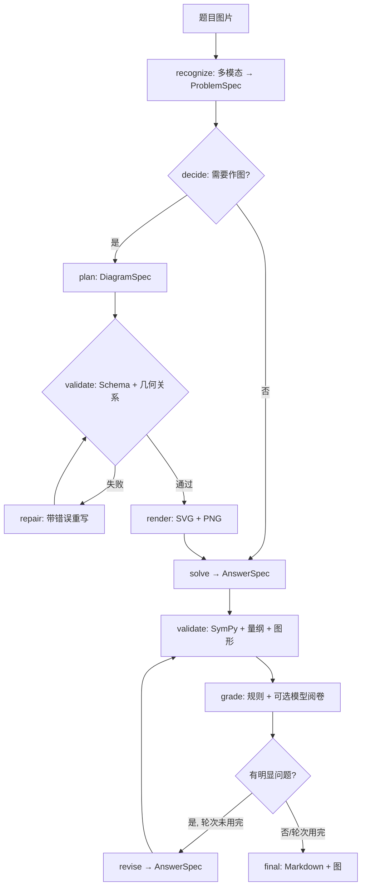

# 架构说明

## 1. 设计目标

1. **原图不丢**：识别阶段的图片以原生 image block 送入模型；OCR 只是辅助，不存在“转成文本后丢图”的路径。
2. **决策与执行分离**：LLM 决定「画什么」，Renderer 决定「怎么画」；LLM 负责推理，Validator 尽可能负责验证。
3. **可复现**：所有数值/符号结论都在 Python 进程中计算，可通过一次 `stdin/stdout` JSON 交互脱离插件复现。
4. **可失败**：信息不足时输出 `uncertainties` 与较低的 `status`，而不是编造条件。

## 2. 进程与职责边界

```
┌──────────────────────── DeepSeek Harness (Host) ────────────────────────┐
│  tools service     llm service      attachments      sessions/agents    │
│       ▲                 ▲                ▲                  ▲           │
│       │ register        │ stream         │ saveImage          │ messages  │
│  ┌────┴─────────────────┴────────────────┴──────────────────┴────────┐  │
│  │                    exam-diagram-solver (Node ESM)                  │  │
│  │  tools.js → pipeline.js → prompts.js / normalize.js / decide.js   │  │
│  │                    │ JSON over stdin/stdout                       │  │
│  └────────────────────┼───────────────────────────────────────────────┘  │
└───────────────────────┼─────────────────────────────────────────────────┘
                        ▼
          python -m exam_solver  (ops.py)
            ├── schema/      严格 JSON Schema 校验（自研，无第三方依赖）
            ├── diagrams/    Canvas(SVG/Matplotlib) + 6 类 Renderer
            ├── validators/  diagram / math(SymPy) / physics(量纲)
            └── examiner/    规则评分
```

- **Node 侧**只做三件事：与 Harness 交互、组织模型调用、把结构化结果编排成流程。
- **Python 侧**不接触 Harness、不读配置、不写日志，只接收一个 JSON 请求并返回一个 JSON 响应。
- 两侧都遵守同一份 `schemas/*.schema.json`。

## 3. 流水线与数据流



### 阶段与失败策略

| 阶段 | 输入 | 输出 | 失败时 |
|---|---|---|---|
| recognize | 图片、学科/年级提示 | ProblemSpec | 结构修复重试 1 次；仍失败则整体失败并给出错误 |
| decide | ProblemSpec | `{required, role, type, rules}` | 规则纯函数，不会失败 |
| plan | ProblemSpec、图片 | DiagramSpec | Schema/关系修复最多 N 次；仍失败则 `status=partial`，继续文本解答 |
| solve | ProblemSpec、DiagramSpec、图片 | AnswerSpec | 结构修复 1 次；仍失败则整体失败 |
| validate | 三者 | ValidationReport | 报告失败项，不抛错 |
| grade | 三者 + 报告 | ExamReport | 模型阅卷失败时退回规则评分 |
| revise | 问题清单 | 新 AnswerSpec | 单轮失败即停止，保留已有结果并提示 |

修正轮数：`fast=0`、`balanced=min(1, config)`、`high=config.maxRevisionRounds`（默认 2）。

## 4. 关键数据结构

- **ProblemSpec**：`subject`、`problem_type`、`question_format`、`conditions`、`questions`、`equations`、`symbols`、`visual_objects`、`visual_relations`、`uncertainties`、`recognition_confidence`。
- **DiagramSpec**：6 个变体（geometry / coordinate / function / force / circuit / optics / chart 中 chart 与 coordinate 共用入口），全部严格。
- **AnswerSpec**：`steps[{content, reason, score_relevance}]`、`final_answer`、`verification[]`、`confidence`。
- **ValidationReport / ExamReport**：逐项检查、矛盾点、修改建议；估分标注 `source: internal_estimate`。

`verification` 是整个验证体系的关键：模型必须把结论写成可执行断言，程序再独立重算。这样“模型说它检查过”被替换为“程序实际检查了什么”。

## 5. 图形引擎

- `Canvas` 提供与分辨率无关的图元（线、折线、多边形、圆、弧、点、文本、箭头），并维护 world→screen 变换（支持 y 翻转、等比/非等比缩放、自动 fit）。
- `SVGCanvas` 输出确定性 SVG（规范输出，可 diff）；`MplCanvas` 用 Matplotlib Agg 输出 PNG 预览（可选依赖，缺失时降级）。
- Renderer 只计算“画在哪里”，不判断“是否符合题意”；后者属于 `validators/diagram_validator.py`。
- 几何标签使用屏幕空间贪心避让；直线裁剪用 Liang–Barsky；函数采样在非有限值与渐近跳变处断开。

## 6. 验证体系

| 验证器 | 方法 | 能发现 | 不能发现 |
|---|---|---|---|
| diagram_validator | 坐标数值计算 | 垂直/平行/共线/等长/共圆/点在线上等矛盾、未定义点、重点、零长线段 | 图形美感、标注语义 |
| math_validator | SymPy + 数值抽查 | 错的根、错的恒等式/导数/积分、数值偏差 | 无法形式化的证明步骤 |
| physics_validator | 量纲向量 + 数量级 | 缺单位、量纲错、荒谬量级 | 物理模型选错 |
| examiner | 规则 + 可选模型 | 步骤缺失、跳步、无图、无单位、内部矛盾 | 真实考试评分 |

所有报告区分 `passed / failed / skipped`，跳过必须给出原因，且不计入“通过”。

## 7. 扩展指南

- **新增图类型**：在 `schemas/diagram_spec.schema.json` 增加变体 → 在 `diagrams/` 实现 renderer → 在 `render.py` 注册 dispatch → 在 `lib/prompts.js` 增加 DSL 说明 → 补测试。
- **新增验证断言**：在 `answer_spec` 的 `oneOf` 中增加 kind → 在 `math_validator.py` 增加执行分支 → 在提示词中说明格式。
- **新增学科**：ProblemSpec 已允许扩展 `problem_type`；需要新的视觉对象时同时更新 `visual_objects.kind` 与 `normalize.js`。
